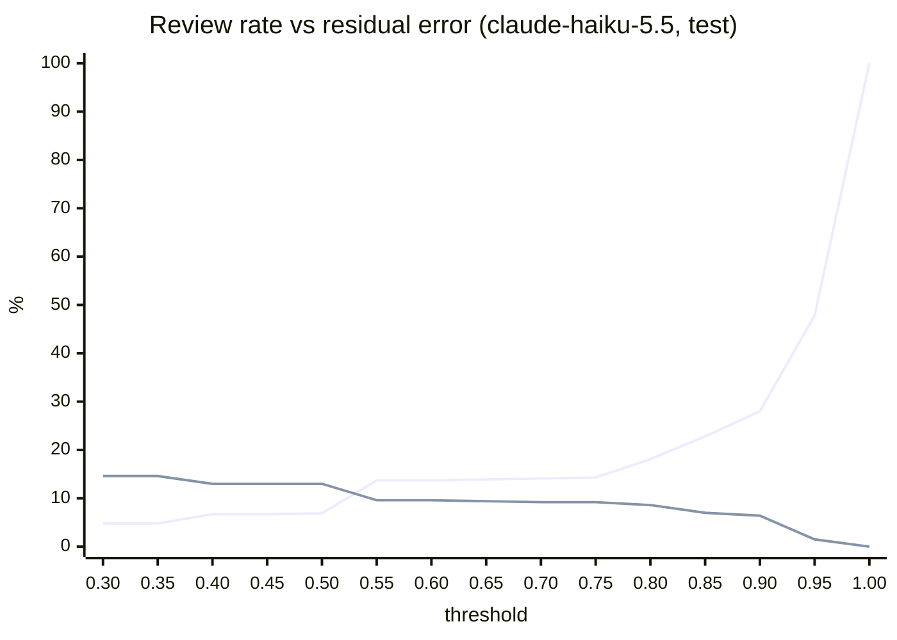

# Evaluation report — 2026-10-27

> Synthetic data only. Not a medical device. Numbers describe this synthetic benchmark, not clinical performance.

## Setup

- Test split: **51 notes**, 474 ground-truth facts (patient-level split; calibration and model choice used the dev split only).
- Models: `anthropic/claude-haiku-5.5`, `google/gemini-2.5-flash-lite`, `mistralai/mistral-small-3.2-24b-instruct`; sample 0 at temperature 0 is the extraction, samples 1-2 (T=0.7) only feed the agreement signal.
- Recall: facts of the note found (lenient concept match: same code, or same LOINC analyte with another specimen). Precision: predictions that are correct, counting as correct a condition/medication/procedure present in the patient's record up to the note's date. Strict variants: same code and right value, note facts only.
- 95% intervals: bootstrap over documents (1000 resamples).

## Pseudonymisation (test notes, it_core_news_lg)

- Strict span recall **1.000** on 339 injected PII spans (target >= 0.98); fiscal code **1.000** (target 1.00).
- Missed or leaked spans: 0. The hand-written hard cases in `reports/pseudonymisation.md` are the honest picture.

## Extraction quality

| model | precision | recall | F1 [95% CI] | F1 strict | failed notes |
|---|---|---|---|---|---|
| `anthropic/claude-haiku-5.5` | 0.812 | 0.865 | **0.838** [0.786, 0.877] | 0.709 | 0 |
| `google/gemini-2.5-flash-lite` | 0.691 | 0.808 | **0.745** [0.706, 0.780] | 0.668 | 0 |
| `mistralai/mistral-small-3.2-24b-instruct` | 0.750 | 0.791 | **0.770** [0.728, 0.809] | 0.703 | 0 |

### By resource type — `anthropic/claude-haiku-5.5`

| type | facts | predicted | precision | recall | F1 | F1 strict |
|---|---|---|---|---|---|---|
| Encounter | 51 | 44 | 1.000 | 0.863 | 0.926 | 0.926 |
| Condition | 32 | 64 | 0.453 | 0.656 | 0.536 | 0.438 |
| Observation | 285 | 292 | 0.908 | 0.989 | 0.947 | 0.749 |
| MedicationStatement | 41 | 44 | 0.841 | 0.902 | 0.871 | 0.871 |
| Procedure | 65 | 52 | 0.538 | 0.400 | 0.459 | 0.444 |

### By resource type, F1, all models

| type | `claude-haiku-5.5` | `gemini-2.5-flash-lite` | `mistral-small-3.2-24b-instruct` |
|---|---|---|---|
| Encounter | 0.926 | 0.959 | 1.000 |
| Condition | 0.536 | 0.421 | 0.524 |
| Observation | 0.947 | 0.785 | 0.817 |
| MedicationStatement | 0.871 | 0.854 | 0.756 |
| Procedure | 0.459 | 0.604 | 0.527 |

### Field accuracy on matched facts

Code = exact code (lenient matches can differ in specimen; for the encounter: class). Value and unit for numeric observations; date where the fact has one.

| field | `claude-haiku-5.5` | `gemini-2.5-flash-lite` | `mistral-small-3.2-24b-instruct` |
|---|---|---|---|
| code | 88.0% | 91.9% | 93.3% |
| value | 100.0% | 99.6% | 99.6% |
| unit | 98.9% | 92.2% | 91.4% |
| date | 98.5% | 93.7% | 94.9% |

### By note type, F1

| note type | `claude-haiku-5.5` | `gemini-2.5-flash-lite` | `mistral-small-3.2-24b-instruct` |
|---|---|---|---|
| discharge (13) | 0.774 | 0.674 | 0.670 |
| lab (19) | 0.935 | 0.802 | 0.808 |
| outpatient (19) | 0.728 | 0.710 | 0.779 |

## Confidence and routing (threshold fixed on dev, measured on test)

| model | AUC | threshold | to review [95% CI] | residual error on auto-written [95% CI] | correct facts written automatically |
|---|---|---|---|---|---|
| `anthropic/claude-haiku-5.5` | 0.894 | 0.84 | 20.6% [15.5%, 27.0%] | **7.6%** [3.2%, 12.5%] | 76.8% |
| `google/gemini-2.5-flash-lite` | 0.920 | 0.82 | 35.7% [29.9%, 42.4%] | **6.3%** [3.4%, 9.5%] | 69.2% |
| `mistralai/mistral-small-3.2-24b-instruct` | 0.911 | 0.84 | 40.9% [35.9%, 45.7%] | **4.8%** [2.1%, 7.8%] | 58.9% |

### Threshold curve on test — `anthropic/claude-haiku-5.5`

| threshold | to review | residual error |
|---|---|---|
| 0.30 | 4.8% | 14.6% |
| 0.35 | 4.8% | 14.6% |
| 0.40 | 6.7% | 13.0% |
| 0.45 | 6.7% | 13.0% |
| 0.50 | 6.9% | 13.0% |
| 0.55 | 13.7% | 9.6% |
| 0.60 | 13.7% | 9.6% |
| 0.65 | 13.9% | 9.4% |
| 0.70 | 14.1% | 9.2% |
| 0.75 | 14.3% | 9.2% |
| 0.80 | 18.1% | 8.6% |
| 0.85 | 22.8% | 7.0% |
| 0.90 | 28.0% | 6.4% |
| 0.95 | 47.8% | 1.5% |
| 1.00 | 100.0% | 0.0% |

(first line: share sent to review; second: error among auto-written)

## Cost and latency

| model | USD / note | USD / note incl. 2 agreement samples | s / note | tokens in / out |
|---|---|---|---|---|
| `anthropic/claude-haiku-5.5` | 0.00129 | 0.00384 | 8.6 | 2705 / 2034 |
| `google/gemini-2.5-flash-lite` | 0.00051 | 0.00151 | 4.1 | 823 / 1153 |
| `mistralai/mistral-small-3.2-24b-instruct` | 0.00032 | 0.00099 | 14.8 | 824 / 1060 |

Latency is wall-clock per request through OpenRouter (provider queueing included).

## Calibration (dev)

| model | AUC out-of-fold | threshold | weights (evidence, fields, valid, coding, agreement) |
|---|---|---|---|
| `anthropic/claude-haiku-5.5` | 0.931 | 0.84 | -0.02, +1.23, -0.00, +2.18, +1.31 |
| `google/gemini-2.5-flash-lite` | 0.934 | 0.82 | -0.17, +1.00, -0.04, +3.01, +0.95 |
| `mistralai/mistral-small-3.2-24b-instruct` | 0.911 | 0.84 | -0.27, +0.82, -0.14, +2.51, +1.63 |
