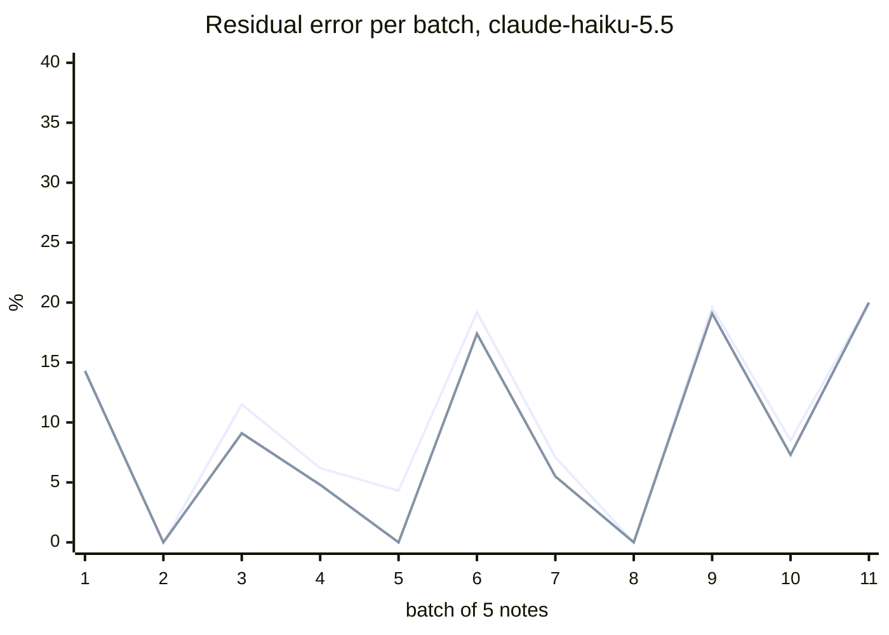
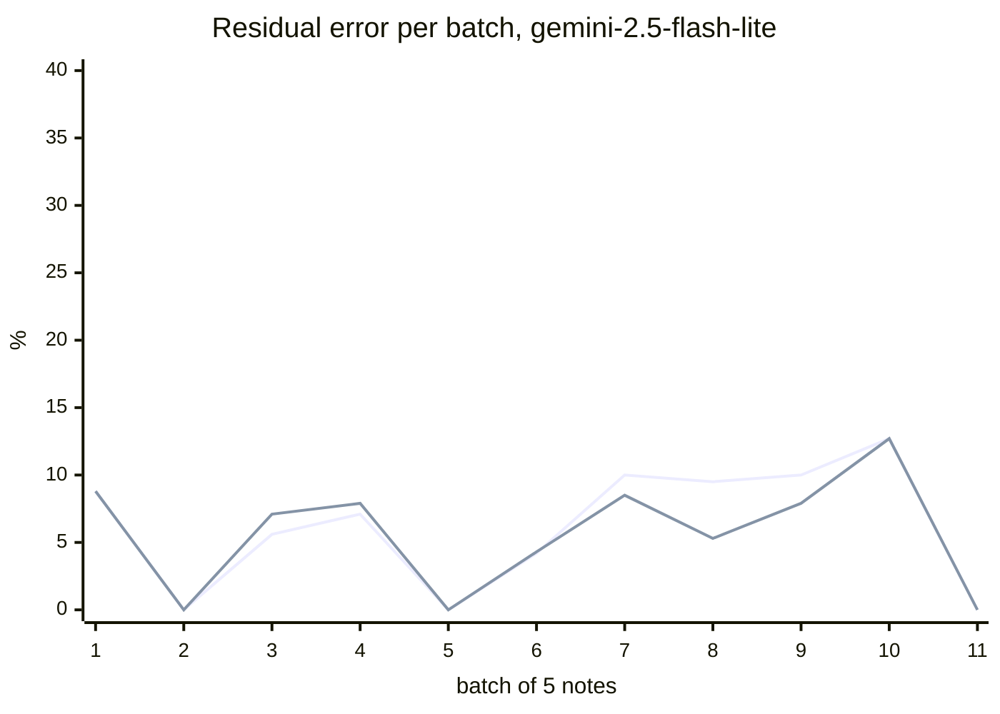
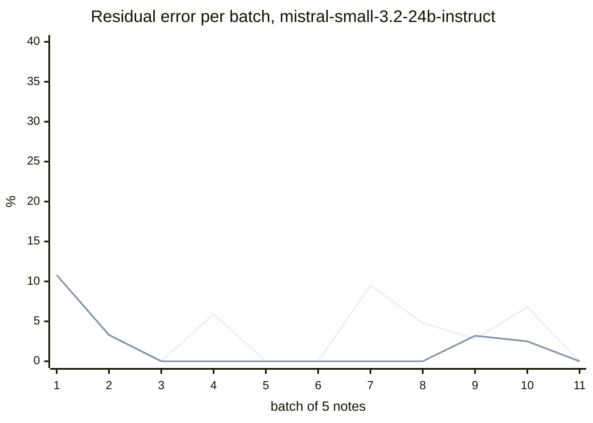

# Learning from the reviewer

Deployment simulation on the **test split** (notes in date order). A simulated physician
(oracle from the ground truth) decides every below-threshold item; in the adaptive policy
they also audit a random share of auto-written items, and the threshold is re-estimated
after each batch with the bootstrap-safe rule on dev labels plus production labels
(audits weighted by 1/audit rate). The confidence weights stay those fitted on dev.

| model | policy | threshold | residual error on auto-written | sent to review | human workload (review + audit) |
|---|---|---|---|---|---|
| `anthropic/claude-haiku-5.5` | fixed, point rule (until M7) | 0.71 | 9.2% | 14.3% | 14.3% |
| | fixed, bootstrap-safe rule | 0.84 | 7.6% | 20.6% | 20.6% |
| | adaptive, 20.0% audit (20 seeds) | 0.71 → 0.90 | 6.2% [3.4%–8.4%] | 27.7% | 42.4% |
| `google/gemini-2.5-flash-lite` | fixed, point rule (until M7) | 0.81 | 7.2% | 33.8% | 33.8% |
| | fixed, bootstrap-safe rule | 0.82 | 6.3% | 35.7% | 35.7% |
| | adaptive, 20.0% audit (20 seeds) | 0.81 → 0.88 | 6.5% [5.2%–7.3%] | 41.6% | 53.4% |
| `mistralai/mistral-small-3.2-24b-instruct` | fixed, point rule (until M7) | 0.83 | 5.2% | 37.5% | 37.5% |
| | fixed, bootstrap-safe rule | 0.84 | 4.8% | 40.9% | 40.9% |
| | adaptive, 20.0% audit (20 seeds) | 0.83 → 0.88 | 4.2% [3.3%–5.5%] | 54.2% | 63.6% |

Small numbers: the test split has 51 notes, so a few items move these percentages.

## anthropic/claude-haiku-5.5: residual error per batch (seed 0)

(first line: fixed point-rule threshold; second: adaptive)

| batch | adaptive threshold | auto | wrong | reviewed | audited |
|---|---|---|---|---|---|
| 1 | 0.71 | 42 | 6 | 14 | 3 |
| 2 | 0.84 | 37 | 0 | 8 | 6 |
| 3 | 0.84 | 22 | 2 | 8 | 1 |
| 4 | 0.83 | 42 | 2 | 14 | 14 |
| 5 | 0.85 | 43 | 0 | 7 | 6 |
| 6 | 0.83 | 23 | 4 | 12 | 4 |
| 7 | 0.83 | 55 | 3 | 7 | 11 |
| 8 | 0.83 | 25 | 0 | 8 | 7 |
| 9 | 0.82 | 47 | 9 | 14 | 8 |
| 10 | 0.86 | 55 | 4 | 7 | 13 |
| 11 | 0.83 | 5 | 1 | 1 | 0 |

## google/gemini-2.5-flash-lite: residual error per batch (seed 0)

(first line: fixed point-rule threshold; second: adaptive)

| batch | adaptive threshold | auto | wrong | reviewed | audited |
|---|---|---|---|---|---|
| 1 | 0.81 | 34 | 3 | 24 | 1 |
| 2 | 0.85 | 28 | 0 | 23 | 5 |
| 3 | 0.85 | 14 | 1 | 26 | 3 |
| 4 | 0.85 | 38 | 3 | 22 | 5 |
| 5 | 0.83 | 37 | 0 | 16 | 12 |
| 6 | 0.82 | 23 | 1 | 23 | 4 |
| 7 | 0.82 | 47 | 4 | 17 | 6 |
| 8 | 0.82 | 19 | 1 | 17 | 5 |
| 9 | 0.82 | 38 | 3 | 20 | 8 |
| 10 | 0.82 | 55 | 7 | 15 | 10 |
| 11 | 1.00 | 0 | 0 | 8 | 0 |

## mistralai/mistral-small-3.2-24b-instruct: residual error per batch (seed 0)

(first line: fixed point-rule threshold; second: adaptive)

| batch | adaptive threshold | auto | wrong | reviewed | audited |
|---|---|---|---|---|---|
| 1 | 0.83 | 37 | 4 | 15 | 2 |
| 2 | 0.84 | 30 | 1 | 17 | 4 |
| 3 | 0.93 | 1 | 0 | 29 | 0 |
| 4 | 0.93 | 0 | 0 | 54 | 0 |
| 5 | 0.93 | 0 | 0 | 51 | 0 |
| 6 | 0.93 | 2 | 0 | 33 | 0 |
| 7 | 0.94 | 1 | 0 | 60 | 1 |
| 8 | 0.93 | 0 | 0 | 38 | 0 |
| 9 | 0.87 | 31 | 1 | 23 | 3 |
| 10 | 0.87 | 40 | 1 | 29 | 13 |
| 11 | 0.90 | 2 | 0 | 3 | 1 |

